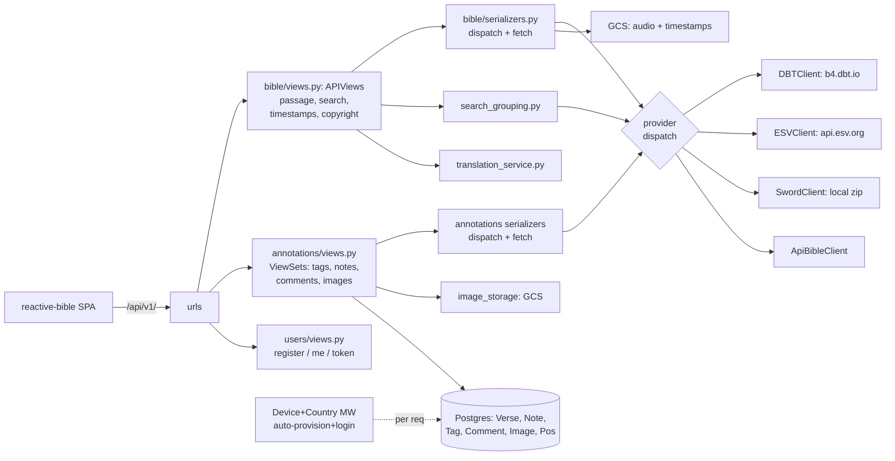

# bible_research — architecture review

Status: implemented (read-only review; no code changes).

## Executive summary

Verdict: **needs work**. The codebase shows strong local
craftsmanship — careful edge-case comments, real test coverage,
a clean provider-error contract — but has systemic layering
problems. There is no provider abstraction: the same
`is_esv → is_apibible → is_sword → else DBT` dispatch chain is
reimplemented in at least six places, including inside a
serializer that performs upstream HTTP calls. The auth
middleware performs writes (user rows, sessions) on almost every
request, and three deployment targets (GCP / Vercel / local) are
still wired through settings.py even though only App Engine is
live. Doc drift is significant: three documents claim three
different Django versions (4.2.6 / 5.2 / 6.1.x installed).

## Architecture map

## Findings by area

### 1. Project layout & app boundaries

The three-app split is coherent in intent: `bible/` = read-only
content + upstream providers, `annotations/` = user-owned rows,
`users/` = auth surface. Leakage exists in one direction:

- `annotations/serializers.py:7-24` imports five provider
  clients/registries directly and re-implements the whole
  dispatch chain at `serializers.py:377-546` — annotations
  reaches past `bible`'s public surface into provider internals.
- `bible/utils/` has no `__init__.py` (namespace package);
  every other package has one. Documented in AGENTS.md but an
  inconsistency that trips tooling.
- `bible_research/utils.py` is an empty dead file.
- `users/` is thin but coherent (no models, two views, one auth
  backend); the case-insensitive backend belongs there.

### 2. Layering

Business logic sits in the wrong layer in the two biggest files:

- `bible/serializers.py:102-417` — `to_representation` contains
  the entire provider dispatch, upstream fetch, verse
  filtering, and error mapping. It is invoked as
  `serializer.to_representation(data)` on a `Serializer(data=)`
  instance (`bible/views.py:281-287`) — an unusual misuse of
  the serializer contract (validation is essentially bypassed;
  it works only because `is_valid()` barely checks anything).
- `bible/views.py:727-899` — five private per-provider search
  methods (~250 lines) that are service-layer code.
- `annotations/views.py` is 1887 lines; `reorder`/`move` carry
  ~150 lines of hand-rolled request-body validation
  (`views.py:754-889`, `1089-1125`) that belongs in a
  serializer.
- `annotations/serializers.py:364-560` —
  `NoteSerializer.to_representation` performs blocking upstream
  HTTP fetches per note (see Systemic issues).
- `translation_service.py` is the only real service class and
  covers only the translations listing; there is no equivalent
  for passages/audio/search.

### 3. Provider abstraction

There is **no common interface**. Providers share only informal
conventions: `is_*_fileset()` registry predicates, per-module
`get_default_*_client()` double-checked-locking singletons
(`dbt/client.py:384`, `esv/client.py:298`,
`sword/client.py:229`, `apibible/client.py:408`), and a
de-facto `{verse_start, verse_text}` row shape.

The dispatch chain is duplicated in at least six places:

- `bible/serializers.py:123-337` (passage text/audio)
- `bible/views.py:391-452` (timestamps)
- `bible/views.py:707-720` (search dispatch)
- `bible/views.py:796-816` (grouped search)
- `annotations/serializers.py:377-497` (note verse text)
- `bible/services/fileset_groups.py:236-243` (option kind)

Return shapes are normalized enough to share code (each
callsite still re-maps `verse_start/verse_text` itself). Error
handling is unified only at the boundary:
`provider_errors.py:23-74` introspects `.status` /
`.response.status_code` across `ApiException` and
`requests.HTTPError` — clever and correct, but each provider
raises a different exception vocabulary
(`PassageNotFoundError`, `ValueError`, `HTTPError`,
`ApiException`) that the classifier papers over.

Other gaps:

- No response caching for passages or translations — every
  `/bible/translations/` call hits DBT live
  (`translation_service.py:44`), plus in-process SwordClient /
  signed-URL caches are the only caches that exist.
- `DBTClient.__init__(api_key=None)` ignores its argument —
  line `dbt/client.py:42` overwrites the parameter with
  `getattr(settings, 'DBT_KEY')` (no default → `AttributeError`
  not the intended `ValueError` when unset).
- The DBT client mixes two HTTP stacks: a 217-file vendored
  generated OpenAPI package (`sys.path.append` hack,
  `dbt/client.py:16-17`) and raw `requests` calls for
  timestamps/copyright/search (`client.py:268-377`).
- `TranslationService.get_live_translations` swallows DBT
  failures and returns partial data silently
  (`translation_service.py:52-55`).

### 4. Cross-cutting concerns

- **Middleware does writes on nearly every request.**
  `DeviceAndCountryMiddleware` runs `login()` (session write)
  and `User.objects.get_or_create`-equivalent logic
  (`middleware.py:125-182`) for any non-`/admin`, non-public
  request where session auth fails — including Token/Bearer
  API calls (DRF auth hasn't run yet at middleware time) and
  Swagger/schema GETs (`/api/v1/docs`, `/api/v1/comments/`,
  `/api/v1/images/` are not in `PUBLIC_READ_PREFIXES`,
  `middleware.py:16-20`). Usernames are `Accept-Language +
  User-Agent` strings → the user table accretes a row per UA
  variant (`middleware.py:132-150`).
- `print()` used for all middleware diagnostics
  (`middleware.py:44,71,117,150,158,161,174,182`) — bypasses
  log levels and logs the full User-Agent per request.
- **No `CsrfViewMiddleware`** in production `MIDDLEWARE`
  (`settings.py:45-54`); `CSRFExemptSessionAuthentication`
  (`authentication.py:19-31`) + session login means SameSite=Lax
  cookies are the only CSRF defense. `conftest.py:45` adds
  CsrfViewMiddleware prod doesn't have.
- `GuestReadOnly` hardcodes the username `'guest'`
  (`permissions.py:32`); `scripts/create_test_user.py:77`
  gives that shared account a real, documented password
  (`guest_password_123`) — overriding the middleware's
  unusable-password intent.
- `ALLOWED_HOSTS = ["*"]` (`settings.py:23`) and
  `CORS_ALLOW_ALL_ORIGINS = True` (`settings.py:56`) —
  acceptable for a public token-API, but combined with session
  auth it weakens the CORS story.
- Secrets: good shape — Secret Manager on GCP (`gcp.py`),
  gitignored `config.yaml` locally, graceful `API_BIBLE_KEY`
  fallback (`settings.py:103-108`).
- Logging: `file_error` handler is created but never attached
  to a logger (`settings.py:448`, loggers at 450-466);
  `'annotations'` logger sets `propagate=True` while handlers
  also emit → duplicate lines (`settings.py:461-465`).
- Token login lives at `/api/token/` outside the `/api/v1/`
  prefix (`bible_research/urls.py:18`) — minor version-skew.

### 5. Data model

- Prefixed string PKs are a fine choice but use two
  conventions: `TAG`/`NOT`/`NVE`/`VER`/`RDP` have no separator
  while `CMNT_`/`IMG_` use underscore
  (`annotations/models.py:11-12,78-79,172-173,262-263,362-363`).
- `Tag.Meta.unique_together = (user, name, parent_tag)`
  (`models.py:65`) does not prevent duplicate top-level names:
  `parent_tag=NULL` rows are distinct under SQL NULL semantics
  (migration 0003 removed the prior top-level constraint).
- `Note.tag_position` is a `FloatField` under a partial unique
  constraint (`models.py:123-158`) — a fragile fractional
  ordering scheme that required a two-phase park-then-renumber
  machinery plus NaN/gap-exhaustion handling
  (`views.py:72-113`, `1122-1245`). Works, but high complexity
  for ordering.
- `NoteVerse` has no `(note, verse)` uniqueness — explicit
  TODO at `models.py:398-400`.
- `Verse` has no `(book, chapter, verse)` uniqueness and stores
  `book` as a display-name string (`bible/models.py:17-20`).
- Good parts: `Image` XOR parent `CheckConstraint`
  (`models.py:343-351`), soft-delete comment tombstones,
  `ReadingPosition` indexes + `unique_together`
  (`models.py:456-471`), `PROTECT` on `NoteVerse.verse`.
- `Note.tag` is `CASCADE` (`models.py:104-112`) — tag deletion
  deletes notes; the view layer mitigates with a 409 guard
  (`views.py:232-271`).

### 6. Error handling consistency

- `bible/` contract is clean: `error` + `error_code` via
  `provider_errors.py`; status map at `views.py:49-53`.
- `annotations/` uses a different shape —
  `{'error': 'validation_error'|'position_conflict', 'message'}`
  (`views.py:763-976`) — mixed with DRF `ValidationError`
  (`views.py:1513-1533`) and `PermissionDenied`. Three
  conventions in one app; the frontend's `error_code` branching
  does not carry over.
- `BiblePassageView`'s catch-all returns `{"error": str(e)}` as
  HTTP 400 (`views.py:333-345`). The comment claims only client
  errors reach it, but any unexpected exception (programmer
  bug) also becomes a 400 embedding exception text.
- `NoteImageViewSet._get_note` 404s on missing notes then 403s
  on inaccessible ones (`views.py:1593-1604`) — reveals
  existence of other users' private notes, unlike
  `CommentViewSet._get_note` which intentionally 404s
  (`views.py:1350-1359`).

### 7. Dependency & packaging hygiene

- `requirements.txt:1` pins `Django==6.1.2`; venv has 6.1.1;
  AGENTS.md says 5.2; DEVELOPER_GUIDE says 4.2.6. All other
  deps are unpinned (`djangorestframework`, `requests`,
  `PyYAML`, `drf-spectacular`, …) → non-reproducible builds.
- Dead/legacy deps: `future; python_version<="2.7"`, `six`.
- Dev deps (`debugpy`, `pytest`, `pytest-django`) share
  requirements.txt and are stripped in the Dockerfile by a
  `grep -v` hack (Dockerfile) — fragile.
- Vendored `bible/services/dbt/dbt_client/` is 5.2 MB / 217
  files including its own generated `test/` tree — deploy
  bloat, patched onto `sys.path` rather than packaged.
- `build_files.sh` runs `makemigrations` and `migrate` —
  Vercel-era leftover; dangerous because local `config.yaml`
  points at the **production** DB.
- `app.yaml` pins `instance_class: F1`,
  `max_instances: 1` — single instance means in-process caches
  are safe but there is zero redundancy.
- `bible/sword_modules/LvGluck8.zip` (1.8 MB) ships in the
  image; `dbt_openapi.json` + `books/esv.json` are dev
  artifacts only used by a one-off command.

### 8. Test infrastructure

- `pytest.ini` collects `annotations bible/tests users`;
  ~11k lines of tests, decent breadth across providers, TTS,
  and permissions. Annotations uses `tests.py` + loose
  `test_*.py` at app root; bible uses a `tests/` package —
  inconsistent convention.
- `conftest.py` manually re-specifies
  INSTALLED_APPS/MIDDLEWARE/TEMPLATES (`conftest.py:21-69`)
  instead of importing settings + overriding deltas — it omits
  corsheaders and (intentionally) the device middleware, adds
  CsrfViewMiddleware prod lacks, and **does not set
  REST_FRAMEWORK**, so tests run under DRF defaults (Session +
  Basic auth, AllowAny). Views relying on default permission
  classes (e.g. `CommentCountView`, `views.py:1492-1500`)
  behave differently under test than prod.
- No tests exercise `DeviceAndCountryMiddleware` directly
  (tests.py:1451 confirms it's absent in tests).
- Vendored `dbt_client/test/` and `dbt_integration_test.py`
  are never collected (testpaths) — dead weight.
- Three pre-existing failures on main are documented in
  AGENTS.md.

### 9. Duplication hotspots and dead code

- Provider dispatch ×6 — the dominant duplication (see §3).
- Signed-URL + credential caching implemented twice:
  `storage/gcs.py:174-237` (unbounded `dict`) vs
  `annotations/services/image_storage.py:68-240` (bounded LRU +
  credential reuse). The audio cache can grow without bound.
- `google_tts/` and `gemini_tts/` are parallel pipelines
  (client/synthesizer/state each) — justified by provider
  differences, but the two `generate_*_audio` commands repeat
  the same lock/budget/worklist orchestration
  (`generate_chapter_audio.py:67-230`).
- Dead code: `settings.py:131-188` Vercel branch,
  `vercel.json`, `build_files.sh`, `scripts/vercel_setup.py`,
  `bible_research/utils.py` (empty), `bible/admin.py` stub,
  `bible/services/dbt/example_usage.py`,
  `dbt_integration_test.py`.
- Unreachable fallbacks: `TagViewSet.perform_create`'s guest
  branch (`views.py:185-200`) can never run — writes already
  require `IsAuthenticated` + `GuestReadOnly`; same for the
  guest fallbacks in `CurrentAuthenticatedUserDefault`
  (`serializers.py:44-55`) and `BulkNoteCreateSerializer.create`
  (`serializers.py:684-690`).

### 10. Doc drift

- `DEVELOPER_GUIDE.md:37` claims Django 4.2.6 (settings
  docstring repeats it, `settings.py:4`); AGENTS.md says 5.2;
  requirements/venv say 6.1.x.
- Guide's project-structure tree (lines 44-66) omits the SWORD,
  ESV, API.Bible, storage, TTS services and the
  comments/images/reading-positions surface.
- Guide's logging section references `logs/django.log`
  (lines ~1408-1414); actual handlers write `debug.log` /
  `error.log` (`settings.py:447-448`) — and `file_error` is
  never attached anyway.
- Workspace `AGENTS.md` claims the `fileset_groups` backend is
  "unmerged on `feat/fileset-groups`" — it is present on the
  current branch (`bible/services/fileset_groups.py`).
- `README.md` links the old `Bible-Research/bible-research`
  GitHub path.

## Systemic issues

1. **No provider abstraction** — every new provider or new
   capability (audio, timestamps, search, copyright) touches
   N dispatch sites; the annotations app already forked it.
   This is the single highest-leverage gap.
2. **Serializer-layer I/O** — `to_representation` performs
   upstream HTTP calls. For notes it is an N+1 over the
   *network*: a 25-note page can issue up to 25 provider
   requests (`annotations/serializers.py:364-560`), only
   partly mitigated by `include_verse_text` flags.
3. **Middleware side-effects per request** — user creation,
   `login()` session writes, and `print` diagnostics on most
   requests, including token-authed ones.
4. **Split error contracts** — `error`/`error_code` in bible/,
   `error`/`message` in annotations/, DRF exceptions
   elsewhere; documented frontend contract covers only half.
5. **Environment/config sprawl** — three env branches in
   settings, three Django versions in docs, duplicated
   settings in conftest, dead Vercel machinery.

## Strengths worth keeping

- `provider_errors.py` is a small, well-reasoned contract —
  never leaks `str(exc)`; correct status mapping.
- Extremely good code comments documenting *why* edge cases
  exist (verse-1 markers, range tails, temp-position parking).
- Concurrency discipline: `select_for_update` on reorder/move
  and image-cap checks, `if_generation_match` CAS for GCS
  usage/locks (`gcs.py:289-459`).
- N+1 awareness in the ORM: `select_related('user')` +
  `build_comment_tree` in Python (`serializers.py:868-901`),
  `prefetch_related` + `.only()` in `order_index`
  (`views.py:1023-1040`).
- Per-provider registries are clean, consistent, and keyless
  for listing.
- Broad test suite (~11k lines) with named regression tests.
- Secrets handling is correct in all three environments.

## Systemic refactoring recommendations

1. **P0 / L — Introduce a provider facade.** A single
   `bible/services/providers.py` exposing
   `provider_for(fileset_id)` → object with
   `get_chapter(book, chapter, verse_range)`, `get_audio`,
   `search`, `get_timestamps`, `get_copyright`,
   `translation_listing`. Collapse the six dispatch sites;
   move passage-fetch logic out of `BiblePassageSerializer`
   into the facade so the serializer only maps shapes.
2. **P0 / M — Fix middleware side-effects.** Gate
   auto-provisioning behind an absent `Authorization` header
   and an explicit allowlist of paths that need it; never
   `login()` for API requests; replace `print` with `logger`.
   Add `CsrfViewMiddleware` or drop session auth entirely.
3. **P0 / M — Move verse-text enrichment out of
   `NoteSerializer`.** Batch by `(fileset_id, book, chapter)`
   — notes on one chapter share one upstream call; keep
   `include_verse_text=False` paths unchanged.
4. **P1 / M — Unify the error contract.** One response helper
   emitting `error`/`error_code` (+ optional `message`) for
   annotations too; replace `{"error": str(e)}` at
   `views.py:342` with a fixed message for unexpected errors.
5. **P1 / S — Centralize the guest account.** A
   `get_guest_user()` helper; delete unreachable guest
   fallbacks (`views.py:185-200`,
   `serializers.py:44-55,684-690`); give `guest` an unusable
   password in the seed script.
6. **P1 / S — Deduplicate GCS signing/credential caching**
   into one shared module; bound `gcs.py`'s URL cache like
   `image_storage.py`'s LRU.
7. **P1 / M — Pin dependencies and prune packaging.** Pin all
   runtime deps, split dev requirements, package or slim the
   vendored DBT client, delete `example_usage.py` /
   `dbt_integration_test.py` / `vercel.json` /
   `build_files.sh` / `vercel_setup.py` / IS_VERCEL branch;
   fix `DBTClient.__init__` arg shadowing (`client.py:42`).
8. **P1 / M — Deduplicate settings in tests.** Have conftest
   import the real settings module and override only
   DATABASES/middleware deltas; mirror `REST_FRAMEWORK` so
   default permission classes are exercised.
9. **P2 / L — Replace float `tag_position`** with
   lexicographic keys or integer positions + reindex jobs;
   add `UniqueConstraint(note, verse)` on `NoteVerse` and
   `(book, chapter, verse)` on `Verse`; decide the
   `parent_tag`-NULL top-level tag-name policy.
10. **P2 / S — Refresh docs.** Bump DEVELOPER_GUIDE +
    AGENTS.md to Django 6.1.x and the current provider map;
    fix the logging-filename section.
