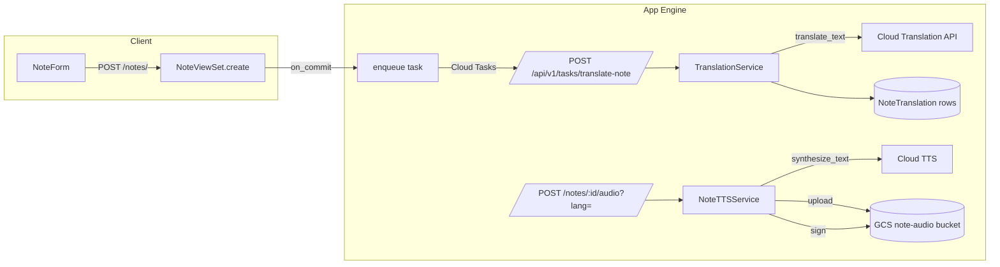

# Note Translations + Note TTS — Investigation & Plan

**Status:** not implemented (investigation + plan only; no
`NoteTranslation` model exists in `bible_research`).

Date: 2026-10-09. Investigates how to auto-translate notes into
multiple languages and generate per-language audio via Cloud TTS.

Decisions confirmed with the user:

- **Hybrid generation**: translate eagerly on create; TTS audio
  lazily on first request.
- **Cloud Tasks worker** for the async pipeline.
- **en + lv** for the first iteration; design stays language-
  agnostic (ru and others are config additions).

## Data-model question the user raised

> "A separate `note_translations` table — won't that be hard on
> Postgres and cause severe slowness?"

No. A child table is the standard relational answer and will NOT
be slow:

- Shape: `NoteTranslation(note_id FK, language, text, status, …)`,
  `UNIQUE(note_id, language)`.
- Each note carries at most 2–3 translation rows; every read is an
  indexed FK lookup returning ≤3 small rows — microseconds, not
  "severe slowness". Even at 1M notes the table is ~3M short rows,
  which Postgres handles trivially.
- This mirrors what the codebase already does: `Comment`,
  `Image`, `NoteVerse` are all FK children of `Note`.
- The alternative — a `translations` JSONField on `Note` — saves
  one JOIN but loses per-language status/retry tracking, indexing,
  partial updates (a failed `ru` retry must rewrite the whole doc),
  and clean querying. Not worth it.
- Only real cost: one extra indexed query (or `prefetch_related`)
  per note fetch — negligible next to the provider call
  `to_representation()` already makes.

## Current state (what already exists)

### Backend (`bible_research/`)

- `Note` (`annotations/models.py`): `user`, `tag`, `note_text`
  (TipTap doc JSON as string; legacy plain text possible),
  `public`, `tag_position`, `verses` M2M, timestamps. No language
  field anywhere. No custom user model; `DeviceAndCountryMiddleware`
  parses `Accept-Language` into `request.language_info` but only
  uses it to build a throwaway username.
- `NoteSerializer.create()` — plain `Note.objects.create` +
  `NoteVerse.objects.bulk_create`. `to_representation()` fetches
  verse text per provider (ESV / API.Bible / DBT) with the
  `error`/`error_code` degradation contract.
- `NoteViewSet` — standard CRUD + `bulk` + `reorder`;
  `get_accessible_notes_qs` = own ∪ public.
- Cloud TTS stack **already built**
  (`bible/services/google_tts/`):
  - `client.py` — `GoogleTTSClient.synthesize_text(text,
    language_code, voice_name, sample_rate_hertz) -> bytes`,
    `QuotaExceeded` mapping, singleton. Reusable as-is for notes.
  - `budget.py` — `CharBudget` in-memory monthly-char ledger.
  - `synthesizer.py` — chapter-specific (SWORD verses → per-verse
    MP3 concat + timestamps); NOT reusable for notes, notes need a
    simpler "text → mp3" path.
  - `registry.py` — per-fileset voice config, SWORD-keyed; notes
    need a per-LANGUAGE registry instead.
- GCS stack (`bible/services/storage/gcs.py`): upload helpers,
  `signed_audio_url` (IAM-signBlob, cached), monthly usage counters
  with `if_generation_match` retries, run locks — all reusable
  patterns. `annotations/services/image_storage.py` has the same
  signed-URL machinery for user content (better template for note
  audio: `gs://` URI stored on the model row, `signed_*_url()` on
  read, bounded LRU cache).
- Infra (terraform): App Engine standard F1 (min=max 1 instance),
  project `bible-research-489314`, runtime SA `…@appspot…`.
  Enabled APIs include `texttospeech`, `storage`, `secretmanager`,
  `run`, `cloudscheduler`. NOT enabled: `translate`, `cloudtasks`.
  Buckets follow a per-purpose pattern (`…-bible-audio`,
  `…-images-originals`, `…-images-thumbnails`); dedicated SAs per
  workload (`audio-generator`, `thumbnail-worker` planned).
  Secrets via `bible_research/gcp.py::get_secret` in GCP envs,
  `config.yaml` locally.
- Auth: token/bearer + auto-provisioned "device" users; anonymous
  requests may still be authenticated (guest fallback).

### Frontend (`reactive-bible/`)

- `note_text` is a serialized TipTap doc (see
  `utils/tiptapContent.ts`: `isTiptapDocString`, `toPlainText`,
  BLOCK_TYPES walk). Rendered via `RichTextView`; edited via
  `RichTextEditor` (TipTap).
- `NoteCard` — heading, verses, note text, comment thread, action
  icons (share / play-from-note / edit / delete). `onPlayFromNote`
  plays the BIBLE audio from that verse, not the note text.
- `addTagNote`/`editNote` in `api.tsx` → `POST/PATCH /api/v1/notes/`.
- Audio infra: Howler + Media Session + `nativeAudio` keep-alive;
  audio URLs cached in `cacheManager`.

## Proposed design



### 1. Model changes (`annotations/models.py`)

```python
class Note(models.Model):
    ...
    source_language = models.CharField(
        max_length=10, blank=True, default='',
        help_text="Detected ISO 639-1 code ('en', 'lv', …).",
    )

class NoteTranslation(models.Model):
    id = CharField PK, default 'NTR'+uuid[:15]
    note = FK(Note, related_name='translations', CASCADE)
    language = CharField(max_length=10)          # 'en', 'lv', 'ru'
    text = TextField(blank=True)                 # translated TipTap JSON
    status = CharField(choices=pending|ready|failed|source,
                     default='pending')
    audio_status = CharField(choices=none|pending|ready|failed,
                           default='none')
    audio_gcs_uri = CharField(max_length=1024, blank=True)
    audio_duration_seconds = FloatField(null=True)
    source_hash = CharField(max_length=64)       # sha256(note_text)
    error = CharField(max_length=255, blank=True)
    created_at / updated_at
    class Meta: UniqueConstraint('note', 'language')
```

Rationale:

- `status='source'` row = the detected source language; `text`
  holds the original doc — every language a reader can pick has a
  uniform row, no special-casing in the serializer.
- `source_hash` makes the Cloud Task idempotent: if the task
  arrives after a newer edit, hashes differ → task no-ops.
- `audio_*` on the translation row keeps text and audio lifecycles
  independent (hybrid: text eager, audio lazy).
- Migration needed: `makemigrations annotations` + `migrate`
  (user runs — workspace rule forbids the agent running it).

### 2. Translation pipeline (eager, via Cloud Tasks)

`NoteViewSet.perform_create` / `perform_update` (when `note_text`
changed): after `serializer.save()`, inside `transaction.on_commit`
call `translation_tasks.enqueue(note.id, source_hash)`:

1. Upsert `NoteTranslation` rows for each configured target
   language → `status='pending'`, `source_hash=<hash>`. Response
   returns immediately — note is usable in source language.
2. `google.cloud.tasks_v2` enqueues
   `POST {app_url}/api/v1/tasks/translate-note/` with OIDC token
   (`tasks-invoker` SA), JSON body `{note_id, source_hash}`.
   Local dev (`not IS_GCP_ENVIRONMENT`): run the worker function
   inline instead — zero-infra fallback.

Worker endpoint (`annotations/views.py` or new `tasks.py`,
`AllowAny` + OIDC verification — verify
`Authorization: Bearer <oidc>` via
`google.oauth2.id_token.verify_oauth2_token` and check
`email == TASKS_INVOKER_SA`; reject 401 otherwise. Cloud Tasks
auto-retries on non-2xx):

1. Load note; compare `source_hash` — stale task → 204 no-op.
2. Detect source: Cloud Translation `translate_text` without
   `source_language_code` returns `detected_language_code`; or call
   `detect_language` once and cache on the note.
3. For each target in `NOTE_TARGET_LANGUAGES` (`['en','lv']`):
   - target == source → copy original text, `status='source'`.
   - else translate the TipTap doc *structurally*: walk the JSON
     tree, collect `text` values of `type:'text'` nodes, send them
     in ONE `translate_text` call (`contents=[…]` batch), splice
     results back in order. Marks (bold/links/scriptureMention
     attrs) survive untouched. Fallback for non-doc strings: single
     plain-text call.
   - failure → row `status='failed'`, `error=<code>`; raise →
     Cloud Tasks retries (exponential backoff, max 5).
4. Persist rows; log chars billed per language.

Why structural translation, not HTML: `note_text` is TipTap JSON,
not HTML. Translating node-by-node preserves the doc schema and
marks exactly; an HTML round-trip would need a JSON↔HTML converter
and risks schema drift.

Cost guardrails: per-note char cap (e.g. skip translation >10k
chars, mark `failed`/`too_long`), target-language list from
settings/env (same `_audio_settings_source` pattern as
`GOOGLE_TTS_*`), monthly Translate usage counter in GCS reusing
`increment_monthly_usage(fileset_id='note-translate')`.

### 3. Lazy audio endpoint

`POST /api/v1/notes/<note_id>/audio/` body `{language}`:

1. Authz: owner or `public` note (reuse `get_accessible_notes_qs`).
2. Resolve text row: `language == note.source_language` → source
   row/original; else `NoteTranslation` with `status='ready'`
   (409 `translation_not_ready` otherwise — consistent with the
   `error`/`error_code` contract).
3. `audio_status='ready'` + blob exists → return signed URL.
4. Else synthesize synchronously (~1–2 s for typical notes; well
   under the 60 s GAE deadline):
   - plain text via a new `annotations/services/tiptap_text.py`
     (30-line port of frontend `toPlainText` — walk doc, collect
     text nodes, `\n` per BLOCK_TYPES).
   - cap input (`NOTE_TTS_MAX_CHARS` ≈ 4000) → 413 if over.
   - voice from a new per-language registry
     `google_tts/note_voices.py` — `NOTE_TTS_VOICES` dict in
     settings: `{'lv': 'lv-LV-Chirp3-HD-Sadachbia', 'en':
     'en-US-Chirp3-HD-*'}`. Chirp 3 HD covers en-US and lv-LV; for
     ru-RU verify Chirp support else use `ru-RU-Neural2-*`/`Standard`.
   - `GoogleTTSClient.synthesize_text` → upload to
     `note-audio/{note_id}/{language}_{voice}.mp3` in a NEW bucket
     `{project}-note-audio` (per-purpose bucket precedent).
   - mutagen → `audio_duration_seconds`; row → `audio_status=
     'ready'`, `audio_gcs_uri`.
5. Return `{audio_url, duration_seconds, expires_in}` — signed via
   the `image_storage.signed_image_url` pattern (parse `gs://`,
   IAM signBlob, bounded LRU cache).

Note deletion: `perform_destroy` → best-effort delete of
`note-audio/<id>/*` (like `delete_original` tolerates 404);
a 30-day bucket lifecycle rule is the safety net.

### 4. Serializer/API contract

`NoteSerializer.to_representation` adds:

```json
"source_language": "lv",
"translations": [
  {"language": "lv", "status": "source", "has_audio": false},
  {"language": "en", "status": "ready",  "has_audio": true}
]
```

Metadata only in list responses — translated text is fetched on
demand via `GET /api/v1/notes/<id>/?lang=en`, which swaps
`note_text` with the translation's `text` (or a dedicated
`GET /notes/<id>/translations/<lang>/` — either is fine; `?lang=`
is less plumbing). Keeps list payloads small; matches the
cache-first frontend style.

On create the response immediately includes `translations` with
`status='pending'` so the UI can render a "Translating…" state
without polling hacks. Frontend refetches the note once after a
short delay (or the notes list already refreshes on navigation).

### 5. Infra changes (terraform)

- `main.tf` `locals.apis` += `translate.googleapis.com`,
  `cloudtasks.googleapis.com`.
- `google_storage_bucket.note_audio` + `objectAdmin` for appspot
  SA (worker runs inside the same app) + 30-day lifecycle.
- `google_cloud_tasks_queue.note_translations`
  (`retry_config{max_attempts=5}`, min/max backoff,
  `max_concurrent_dispatches=5` — protects the single F1 instance
  and Translate/TTS quotas).
- `google_service_account.tasks_invoker` + grant the Cloud Tasks
  service agent `serviceAccountTokenCreator` on it; appspot SA
  gets `roles/cloudtasks.enqueuer`.
- appspot SA gets `roles/cloudtranslate.user` (v3 API).
- `requirements.txt` += `google-cloud-translate`,
  `google-cloud-tasks` (pin ≥7-day-old releases per rules).
- settings: `NOTE_TARGET_LANGUAGES`, `NOTE_TTS_VOICES`,
  `NOTE_TTS_MAX_CHARS`, `NOTE_AUDIO_BUCKET_NAME`,
  `TASKS_INVOKER_SA_EMAIL`, `TASK_QUEUE_ID`, `APP_BASE_URL` —
  same `_audio_settings_source` env/config.yaml pattern.

### 6. Frontend

- `types.ts`: `NoteTranslationMeta`, `Note.source_language`,
  `Note.translations`.
- `api.tsx`: `getNote(id, lang?)`, `requestNoteAudio(noteId,
  lang)`.
- `NoteCard`:
  - SegmentedControl (EN|LV) next to the heading when
    `translations.length > 1`; default = `source_language`.
  - Switching fetches `?lang=` text, caches in-memory (small —
    no localStorage needed; a `Map` in a store slice is fine).
  - "Auto-translated" caption + original-language chip for trust;
    `<Box lang={code}>` on the text container (a11y/SEO).
  - Play button per selected language → `requestNoteAudio` →
    signed URL into Howler (short clips: a dedicated mini
    play/pause `ActionIcon` is enough; reserve the full
    `AudioPlayer`/keep-alive for chapters).
  - States: `pending` → subtle "Translating…" skeleton on the
    switcher; `failed` → tooltip + retry icon re-POSTing the task
    endpoint (or a `POST /notes/<id>/retranslate` admin-ish
    action — simplest: owner-only `retranslate` endpoint that
    re-enqueues).
  - After `editNote` returns, show "translations updating" hint;
    the next list refresh picks up new statuses.
- Do NOT touch verse rendering — verse text follows the selected
  Bible fileset; translating verses is a separate concern and
  legally fraught (copyrighted translations).

## UI/UX recommendations (beyond the core ask)

1. **One card, language switch** — never duplicate note cards per
   language; switching in place keeps tag order, comments, and
   verse selection intact.
2. **Persist the reader's preferred note language** in the Zustand
   store (persisted slice) so returning to a note re-opens the
   last-picked language; default to UI/browser language
   (`navigator.language`) for first-time viewers of public notes.
3. **Public-note win**: translations make `public=true` notes
   shareable across the EN/LV audience — surface the language
   switcher for anonymous viewers too (endpoint already allows
   public notes).
4. **Trust signals**: always label machine output ("Auto-
   translated"), offer "Show original" prominently — MT of
   theological nuance can mislead.
5. **Inline mini-player, not the floating player**: note audio is
   10–60 s; a play/pause icon with a thin progress bar on the card
   is lighter than hijacking the chapter AudioPlayer.
6. **Edit warning**: when the source text changes, translations
   refresh async — a small "translations updating" chip avoids the
   "my edit didn't propagate" confusion.
7. **Comment translations later**: the same `NoteTranslation`
   pattern applies to `Comment` — design the service
   language-agnostic (`translate_texts(texts, source, targets)`)
   so comments reuse it.
8. **Language pick at write time (optional later)**: auto-detect
   works, but a per-note "written in" selector in `NoteForm`
   removes ambiguity for short/mixed-language notes where
   detection is weakest. Skip for MVP — detection is free and
   usually right for paragraph-length notes.
9. **Keyboard/a11y**: `lang` attr per rendered translation; the
   switcher is a real SegmentedControl (arrow-key navigation
   comes with Mantine).
10. **Failure honesty**: surface `status='failed'` as a clickable
    retry, never silently fall back to the source text — that
    would mask a billing/quota problem.

## Alternatives considered

- **Separate Note rows per language** — rejected: pollutes tag
  ordering (`unique_tag_position_per_tag`), duplicates
  verse/comment links, breaks "edit once".
- **JSONField translations on Note** — rejected: loses
  per-language status/indexes (see data-model answer above).
- **Synchronous translate+TTS in POST /notes/** — rejected: adds
  ~5–8 s to note creation on a single F1 instance; Cloud Tasks
  costs a queue but keeps writes fast and retried.
- **Reuse the audio-generator Cloud Run Job** — rejected for text
  translation (batch latency for an interactive feature); its
  pattern (lock/usage/budget) is reused in spirit for counters.
- **Gemini API for translation** — better contextual quality and
  could merge translate+summarize, but Cloud Translation is
  cheaper, purpose-built, supports glossaries (v3) for
  theological terms, and needs no new secret (ADC). Keep Gemini
  as a quality-upgrade path behind the same service interface.
- **translate-then-speak for audio quality** — note: TTS speaks
  the *translated* text, so audio always matches the displayed
  language; source-language audio synthesizes the original text.

## Cost sketch (MVP, en+lv)

- Cloud Translation: ~$20 / 1M chars → a 500-char note ≈ $0.01;
  1k notes ≈ $10. Monthly free tier covers most usage.
- Cloud TTS Chirp 3 HD: ~$30 / 1M chars → a 500-char note audio ≈
  $0.015; lazy generation means only played notes cost.
- GCS: pennies. Cloud Tasks: free tier 1M ops/month.
- Guardrails: `NOTE_TTS_MAX_CHARS`, per-language monthly counters
  in GCS (`state/usage/note-*`), queue concurrency cap.

## Risks

- TipTap schema drift: translated docs must round-trip
  `RichTextView` — cover with a serializer test using a real doc
  fixture incl. `scriptureMention` marks.
- MT quality for theological Latvian is imperfect — the
  "auto-translated" label + original toggle mitigates.
- OIDC verification is the auth boundary for the task endpoint —
  a bug there opens an unauthenticated write path. Test 401s.
- Voice naming per locale (Chirp 3 HD availability for future
  langs like ru-RU) — keep voices in settings, not code.
- Race: edit while task in-flight — `source_hash` check makes it
  a safe no-op; last writer wins.

## File touch-list

Backend: `annotations/models.py` (NoteTranslation,
source_language), `annotations/serializers.py` (translations
meta, `?lang=`), `annotations/views.py` (audio endpoint +
retranslate), new `annotations/services/translation_service.py`,
`annotations/services/note_tts.py`,
`annotations/services/tiptap_text.py`,
`annotations/services/tasks.py` (enqueue + OIDC verify), new task
view + `annotations/urls.py`, `bible/services/google_tts/`
(add `note_voices.py`), `bible_research/settings.py`,
`requirements.txt`, `terraform/{main,buckets→note_audio,
note_tasks}.tf`, tests in `annotations/tests.py`.

Frontend: `types.ts`, `api.tsx`, `NoteCard.tsx` (switcher, badge,
mini-player), `store.tsx` (preferred note language), tests.
Docs: `bible_research/DEVELOPER_GUIDE.md`,
`bible_research/AGENTS.md`, `reactive-bible/AGENTS.md`.

## Rollout

1. Migrations + model + service (flag off).
2. Cloud Tasks queue + worker endpoint (OIDC) — deploy, verify
   enqueue→translate→rows with a curl'd note.
3. Audio endpoint + bucket — verify lazy synth + signed URL.
4. Frontend switcher + mini-player.
5. Enable `NOTE_TARGET_LANGUAGES` in prod; backfill old notes
   with a `translate_notes` management command (`--user`, `--all`)
   only if wanted — default: translate notes created after launch.
